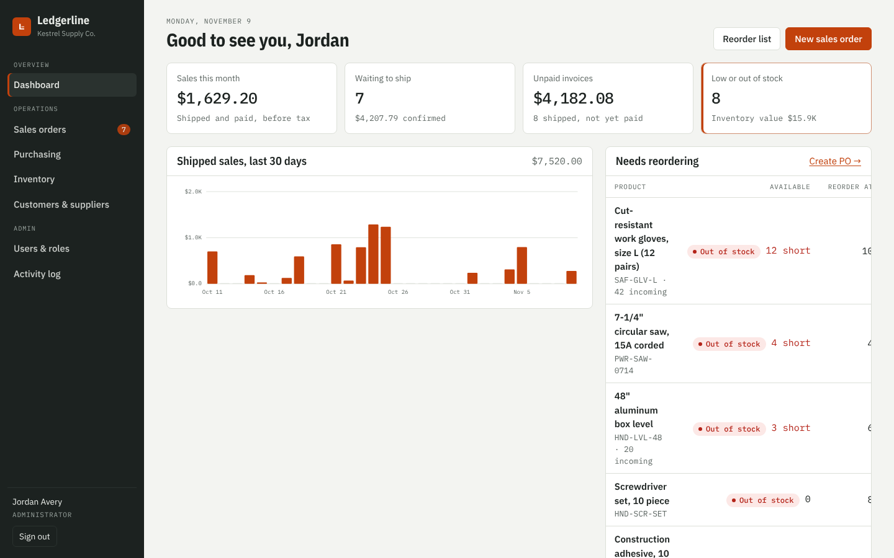
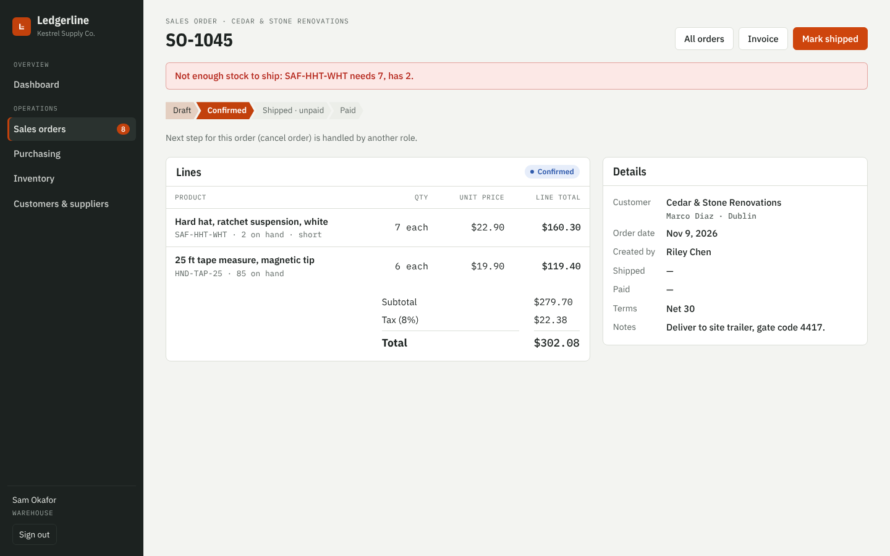
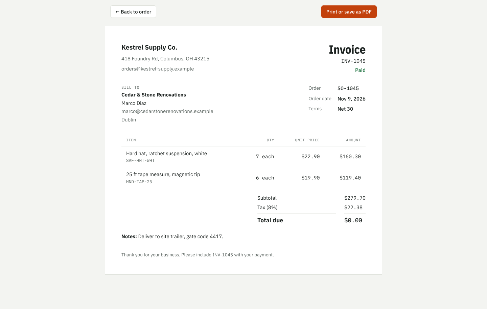
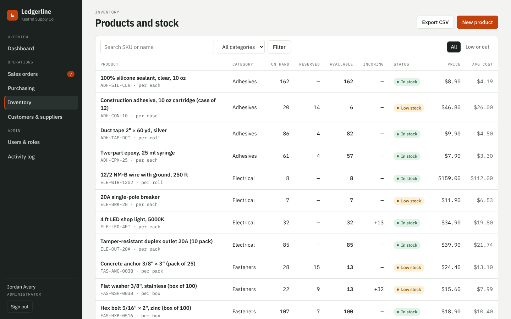
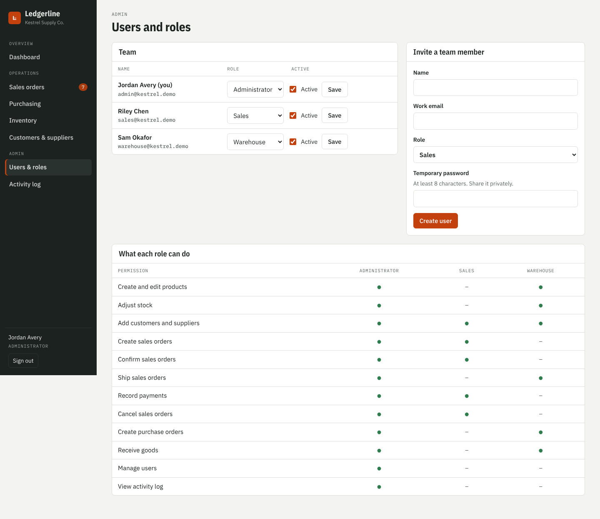
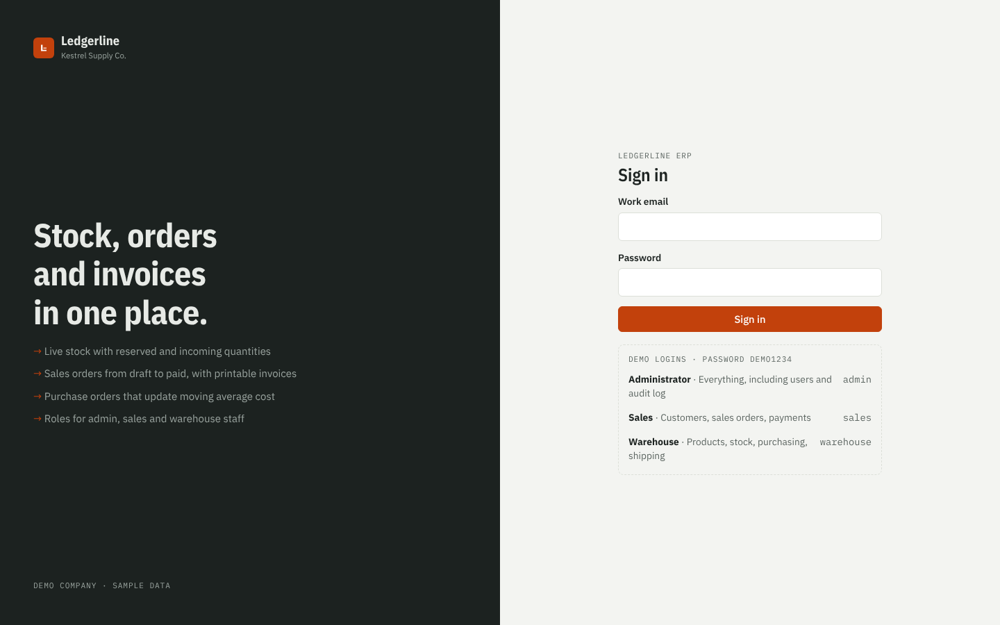
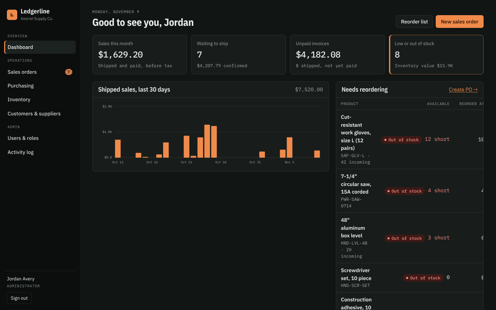

# Ledgerline ERP

A lightweight ERP for small and mid-sized businesses that buy, stock and sell physical goods: distributors, wholesalers, retailers, workshops and light manufacturers.

It covers the core loop every such business runs: **products and stock → sales orders → shipping → invoicing → payment**, and **purchase orders → receiving → cost**, with role-based access for admin, sales and warehouse staff.

Built with Next.js 14 (App Router), a SQL database through libSQL (SQLite locally, Turso in production) and plain CSS. No paid services required.

> **Live demo:** _add your Vercel link here after deploying_ · One-click demo logins for each role on the sign-in page.



| Shipping blocked when stock is short | Printable invoice |
| --- | --- |
|  |  |

| Inventory | Users and permission matrix |
| --- | --- |
|  |  |

| Sign in with demo roles | Dark mode |
| --- | --- |
|  |  |

## Features

**Inventory**
- Products with SKU, category, unit, price, reorder level
- Stock kept as an auditable ledger of movements (opening, receipt, shipment, adjustment)
- On hand, reserved (confirmed orders), available and incoming (open POs) per product
- Moving average cost, recalculated on every receipt
- Low-stock and out-of-stock alerts, stock adjustments with reasons, CSV export

**Sales**
- Sales orders with live line totals and tax
- Status flow: draft → confirmed (reserves stock) → shipped (deducts stock) → paid
- Shipping is blocked inside a database transaction when stock is short, with a clear message per SKU
- Printable invoice with due date from payment terms (print or save as PDF)

**Purchasing**
- Purchase orders: draft → ordered (shows as incoming) → received (adds stock, updates cost)
- One-click reorder from any product

**Dashboard**
- Sales this month, orders waiting to ship, unpaid invoices, low stock, inventory value
- 30-day shipped sales chart, reorder list, recent orders, top products

**Access and audit**
- Email and password sign-in (scrypt hashing), signed HTTP-only session cookie
- Three roles with a clear permission matrix; every action is checked on the server
- Activity log of every change, with who made it
- Users and roles page for administrators

**Quality**
- Unit tests for stock, cost, totals, status flow, permissions and money parsing (`npm test`)
- Works on phones, keyboard accessible, automatic dark mode

## Run it locally

Requires Node.js 18.18 or newer.

```bash
npm install
cp .env.example .env.local      # set SESSION_SECRET
npm run dev
```

Open http://localhost:3000. With `DEMO_MODE=true` the app creates a demo company (Kestrel Supply Co.) with 24 products, customers, suppliers and two months of orders on first start. Sign in with:

| Role | Email | Password |
| --- | --- | --- |
| Administrator | admin@kestrel.demo | demo1234 |
| Sales | sales@kestrel.demo | demo1234 |
| Warehouse | warehouse@kestrel.demo | demo1234 |

For a real business set `DEMO_MODE=false` and add `ADMIN_EMAIL` and `ADMIN_PASSWORD`; the app then starts empty with one administrator.

| Command | What it does |
| --- | --- |
| `npm run dev` | Development server |
| `npm test` | Business rule tests |
| `npm run build && npm start` | Production build |
| `npm run db:reset` | Wipe the local database and seed it again |

## Deploy for free (Vercel + Turso)

1. Create a database at turso.tech and copy its URL (`libsql://…`) and an auth token.
2. Upload this folder to a GitHub repository (without `node_modules`, `.next`, `.env.local` or `*.db`).
3. In Vercel, import the repository and set the environment variables:

   | Name | Value |
   | --- | --- |
   | `DATABASE_URL` | Turso URL |
   | `DATABASE_AUTH_TOKEN` | Turso token |
   | `SESSION_SECRET` | Random string, 32+ characters |
   | `DEMO_MODE` | `true` for a demo, `false` for real use |
   | `DEMO_PASSWORD` | Password for the demo users (demo mode only) |
   | `ADMIN_EMAIL`, `ADMIN_PASSWORD` | First administrator (real use only) |

4. Deploy. Tables and starter data are created on the first request.

## Project structure

```
app/
  login/                     Sign-in with demo user shortcuts
  (erp)/                     Signed-in area with sidebar
    page.js                  Dashboard
    products/                Inventory list, product detail, stock adjustments
    sales/                   Sales orders, new order form, order detail
    purchases/               Purchase orders, receiving
    partners/                Customers and suppliers
    users/                   Users, roles and permission matrix (admin)
    activity/                Audit log (admin)
    OrderForm.js             Shared line-item editor for sales and purchase orders
  invoice/[id]/              Printable invoice
  api/export/[entity]/       CSV export
  actions.js                 Server actions (validated, permission-checked)
lib/
  inventory.js               Pure business rules: average cost, totals, shortages, status flows
  permissions.js             Role → permission matrix
  queries.js                 Database access and transactions
  setup.js                   Schema and demo data
  auth.js, password.js       Sessions and password hashing
  validation.js              Input validation (zod)
tests/                       node:test unit tests
```

## Adapting it

- Company name, address, currency, tax rate and payment terms live in the `settings` table (seeded from `lib/setup.js`).
- Add a role or permission in `lib/permissions.js`; pages and actions pick it up through `requireUser(action)`.
- Typical extensions: multiple warehouses, barcode scanning, customer price lists, email invoices, accounting export.
